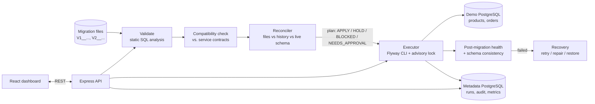
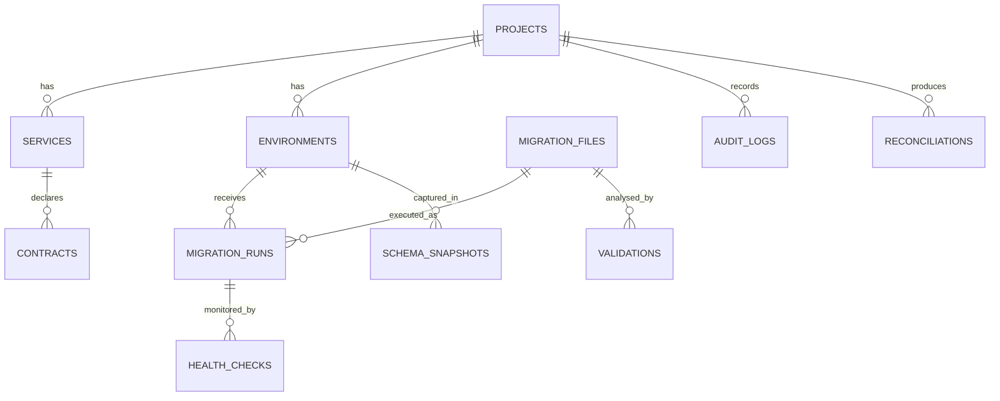

# ReconcileOps: Architecture & Scope (Phase 1)

## 1. Research paper vs. this implementation

**Important:** the EvolveDB paper was not attached to the conversation, so this table is based only on the
paper's title and my general understanding of model-driven schema evolution. Treat the left column as
*unverified* until the PDF is supplied and I re-check it.

| EvolveDB (Eckwert, Guckert, Taentzer 2025), as I understand it, unverified | ReconcileOps (your own implementation) |
|---|---|
| Model-driven: schema changes are expressed on a *model* of the relational schema, and SQL is derived from it | No model-driven tooling. Migrations are plain, version-controlled SQL files |
| Focus on correct, consistent schema evolution | Focus on the *delivery pipeline* around migrations: validate, check compatibility, execute, monitor, recover |
| Research artefact | Working web app with real execution against an isolated demo database |

What we borrow in spirit: *schema changes are first-class, checkable artefacts, not ad-hoc SQL.*
We do **not** claim to implement the paper's algorithms.

## 2. What the system does

### The reconciliation engine (built and tested in this phase)
It compares four things and produces a *plan* instead of blindly running scripts:

1. **Desired state:** migration files in the repo (version + checksum)
2. **Recorded state:** migration history (what ran, whether it succeeded, checksum at that time)
3. **Actual state:** live schema snapshot vs. the schema implied by the successfully applied migrations (drift)
4. **Compatibility requirements:** contracts describing what each deployed service version reads and writes

Findings it can raise: `PENDING`, `OUT_OF_ORDER`, `FAILED_MIGRATION`, `CHECKSUM_MISMATCH`, `MISSING_FILE`, `SCHEMA_DRIFT`.
Plan actions: `APPLY`, `NEEDS_APPROVAL`, `BLOCKED`, `HOLD`. Migrations are strictly sequential, so once one cannot
proceed, every later one is `HOLD`.

### Expand-and-contract in plain language
Renaming a column in one step breaks any running service that still uses the old name. The safe way is three releases:
**expand** (add the new column, keep the old one), **migrate** (copy data, switch services over), **contract**
(drop the old column once nothing uses it). The analyzer tags each statement with its phase, flags *mixed* phases,
and the compatibility check blocks a contract-phase change while a deployed service still depends on it.

## 3. Technical decisions (beginner-friendly)

| Decision | Why |
|---|---|
| **Flyway** (not Liquibase) | SQL-first and easy to explain: `V1__name.sql` files plus a history table. Executed through the Flyway CLI from the backend (`child_process` with an argument array, never a shell string). Needs a JRE, so the backend Docker image will bundle it (Phase 2) |
| Two PostgreSQL databases | **Metadata DB** (ReconcileOps' own data) and **Demo DB** (the thing being migrated). Different credentials, so a bad migration can never damage the app's own records |
| No arbitrary SQL from the API | The executor only runs files from the managed migrations folder, after validation, with a PostgreSQL advisory lock + a unique database constraint to prevent double execution |
| Rollback is never assumed | Each statement is marked reversible or not. Anything irreversible needs explicit approval, and recovery for those is "restore from the pre-migration backup", not "undo" |
| SHA-256 checksum of the file | Detects edits to applied migrations. Flyway keeps its own checksum too; Flyway's `validate` runs as a second line of defence |
| Metrics only from DB rows | Success rate, downtime, rollback time, etc. are computed from `migration_runs` / `health_checks`. Downtime is *measured* by a probe that polls the demo services during a migration; nothing is hardcoded |
| Pure-function engine | Analyzer, compatibility checker, diff and reconciler have no dependencies and no I/O, so they are unit-testable without a database |

## 4. Draft metadata ER diagram (finalised in Phase 2)

## 5. Phases

| Phase | Content | Status |
|---|---|---|
| 1 | Architecture, analyzer, compatibility checker, schema diff, reconciler, 18 unit tests | **Done, tests pass (18/18)** |
| 2 | Metadata schema + Flyway demo migrations, Express API, executor, advisory locks, recovery, audit log | Not started |
| 3 | React dashboard (10 pages), charts, CSV export | Not started |
| 4 | Product/Order demo scenarios (success, incompatible, failed), health probe | Not started |
| 5 | Integration + end-to-end tests, Dockerfiles, Compose, GitHub Actions | Not started |
| 6 | Verify current free-tier hosting options, deployment guide | Not started |

## 6. Honest limits of this environment
The build sandbox has Node 22 but **no PostgreSQL, no Docker and no internet**, so dependencies (`express`, `pg`,
`react`, ...) cannot be installed and nothing that touches a database can be executed here. Only dependency-free code
has been run. Later phases will be written carefully, but anything not run here must be verified on your machine with
`docker compose up` and `npm test` before being treated as working. No public URL exists yet.
